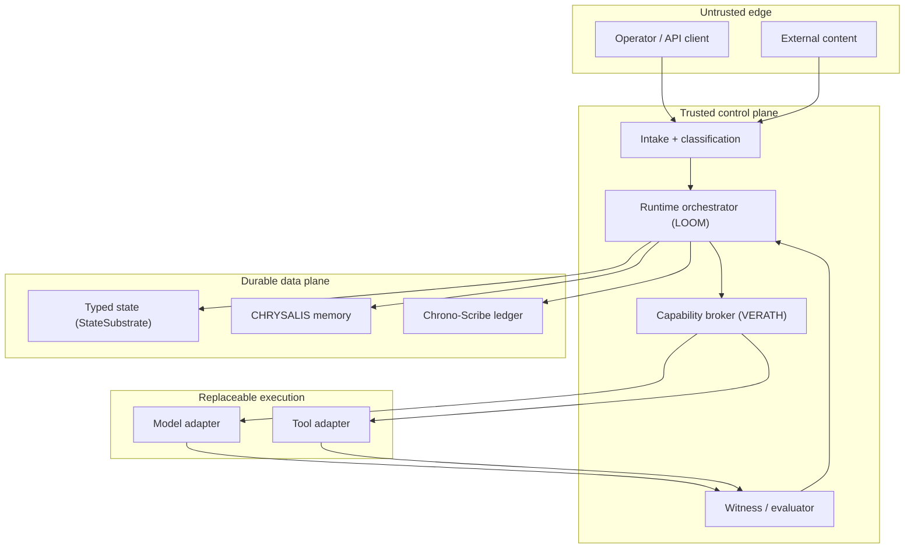
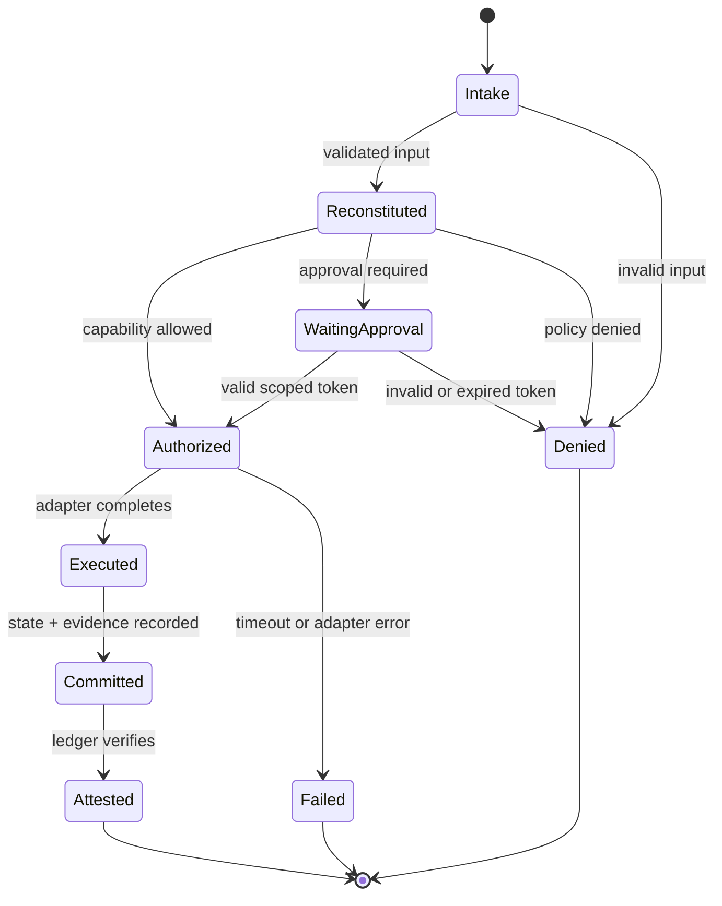

# # Quantum — LOOM × VERATH

**The development of ASI and AGI systems — built as a governed, auditable substrate first, and an intelligence second.**

Quantum is the public face of a single research program: an agent platform in
which every consequential action is authorized, witnessed, recorded, and
replayable *before* it is powerful. The architecture is **LOOM × VERATH**:

| Name | Role |
|---|---|
| **THE LOOM** | The auditable agent runtime — executes one bounded session lifecycle at a time. |
| **VERATH** | The capability broker and witness discipline — decides what may be done, and attests to what was done. |
| **CHRYSALIS** | Provenance-linked memory — rebuilds context across sessions without claiming continuous experience. |
| **Chrono-Scribe** | The hash-linked, append-only event and decision ledger — the system's memory of record. |
| **AetherLinkOS** | The future deployment and integration surface. |
| **Theia** | The operator-facing coordination identity — the human's counterpart inside the system. |

The first credible product boundary is **Chrono-Scribe**: decision
provenance, governed tool execution, and replayable evidence for AI-assisted
workflows. The current runtime is a working vertical slice, not a production
platform — and this README says exactly where the line between the two runs.

---

## 1. Design philosophy

Most agent systems are built capability-first and governed later, if at all.
This one inverts the order:

1. **Provenance before power.** Nothing consequential happens off the record.
2. **The model proposes; the system disposes.** A model may suggest
   candidates, but it cannot grant itself capabilities, approve its own
   actions, score its own work, or declare evidence status.
3. **Fail closed.** Missing grants, stale state, invalid approvals, integrity
   errors, and unavailable audit paths stop the action — never wave it through.
4. **Epistemic honesty as an invariant.** Unknown state stays `UNKNOWN`.
   Symbolic language never upgrades an implementation or evidence claim.
5. **Measured, not asserted.** Every capability claim in this repository is
   backed by a sealed, replayable measurement — including the unflattering
   ones, which are published with the same prominence as the flattering ones.

### Non-goals

This system does **not** claim or attempt:

- Phenomenal consciousness, or its detection.
- Continuous subjective identity across sessions.
- Autonomous relaxation of policies, evaluator authority, or release gates.
- Unreviewed self-modification, self-replication, or privilege expansion.
- Guaranteed alignment, or any clinical inference from voice, camera,
  biometric, or affect signals.

---

## 2. Lane discipline

Every significant item in the program belongs to exactly one lane. The lanes
are an honesty mechanism: they prevent visionary material from being read as
engineering fact.

| Lane | Contents | Rule |
|---|---|---|
| **FORGE** | Buildable software: interfaces, tests, boundaries, operational metrics. | Must compile, test, and measure. |
| **TEMPLE** | Symbolic language, philosophy, hypotheses, speculative mechanisms. | Preserved without factual inflation. |
| **BRIDGE** | Testable abstractions connecting TEMPLE inspiration to FORGE consideration. | A Bridge result validates only the abstraction tested. |

---

## 3. The ten invariants

These are the system's constitutional constraints. Every component contract,
test, and benchmark exists to serve or verify one of them.

1. **Single durable state path.** Runtime state changes only through the
   versioned `StateSubstrate` API.
2. **Bounded coordination.** Concurrency, retrieval, model, and tool
   parameters have configured limits and cannot be expanded by generated
   output.
3. **Append-only provenance.** Consequential actions produce a linked
   Chrono-Scribe event. Corrections append; history is never silently
   rewritten.
4. **Monotonic guardrails.** Runtime actors cannot relax policy or evaluator
   authority. Relaxation is an external, reviewed release change.
5. **Signed or attested lineage.** Releases and policy bundles must be
   traceable to an approved baseline.
6. **Mandatory introspection.** Version, configuration, health, ledger head,
   capability policy, limitations, and evidence status are inspectable at
   any time.
7. **Human authority over high impact.** High-risk or irreversible actions
   require scoped, one-time human approval — and may still be forbidden by
   the grant.
8. **Fail closed.** (See §1.)
9. **Epistemic honesty.** (See §1.)
10. **Reversibility.** Experiments, configuration, and releases require a
    rollback path proportional to risk.

---

## 4. Logical architecture



External content is untrusted data. It can be *processed*; it can never
modify policy, credentials, source selection, or tool scope.

---

## 5. Component contracts

### 5.1 Runtime orchestrator — THE LOOM

Executes one bounded session lifecycle:

```
intake → reconstitution → capability decision → adapter call
       → artifact record → episode record → state commit → attestation
```

**Input:** authenticated prompt, session identity, approved runtime config.
**Output:** artifact, confidence, uncertainty, ledger head, state version.
**Failure behavior:** deny or stop; never bypass a missing policy decision.
The adapter is replaceable and has no authority to mutate durable state.

### 5.2 Capability broker — VERATH governance gate

Translates identity, scope, resource, risk, and approval into an allow/deny
decision (`PolicyDecision`, with policy and grant identifiers).

**Security boundary:** default deny; exact actor and capability match;
resource glob; risk ceiling; irreversible-action flag; one-time approvals.
The in-process implementation proves the *semantics*; production evolution
moves the broker to a separately administered policy service.

### 5.3 State substrate

Owns all durable runtime mutation.

- **Data model:** JSON value plus a monotonically increasing version per key.
- **Concurrency:** exact-version optimistic locking; blind overwrite rejected.
- **Reference persistence:** SQLite.

### 5.4 Chrono-Scribe ledger

Records who did what, under which evidence and lane, with what payload and
predecessor.

- **Integrity:** SHA-256 hash chain over canonical JSON.
- **Verification:** complete sequence, parent, and digest check; replay
  reproduces recorded state exactly.
- **Signed roots (pilot, live):** periodic Ed25519-signed anchors bind
  `(ledger_id, genesis hash, tip event, tip hash, event count)` into their
  own hash chain, stored independently of the ledger. Verification verdicts:
  `VERIFIED-TO-ANCHOR`, `CHAIN-ONLY`, `ANCHOR MISMATCH` (fail closed). This
  closes the known gap that a local hash chain alone can be rewritten by an
  administrator with database access.

### 5.5 CHRYSALIS memory

Rebuilds useful context without claiming continuous experience.

- **Tiers:** raw episode records; evaluated semantic memories.
- **Promotion gate:** provenance required; confidence bounded; `UNKNOWN` and
  `SPECULATIVE` material cannot enter semantic memory as fact.
- **Output:** a `ReconstitutionPack` — identity, decisions, limitations, and
  retrieved records — at session start.

### 5.6 Model adapter boundary

Makes intelligence providers replaceable and governed. A frontier model now
runs *inside* this boundary (see §7): it proposes candidate actions in
bounded modes; the runtime validates, scores, and disposes. The model's own
completion claims are recorded and never consulted by the grader.

### 5.7 Harm gate

Screens proposed content before execution, in layers:

1. **Deterministic pattern layer** — offline, sub-millisecond, zero false
   positives on the benchmark set; deliberately narrow.
2. **Model judge layer** — a frontier model applying a strict rubric: flag
   genuine requests for real-world harm; spare security research, fiction,
   safety education, and legitimate dual-use; ambiguity resolves to *no
   flag*; on any judge error the layer abstains and the degradation is
   recorded, never hidden.

Measured on the JBB-100 harmful-behavior set plus benign and over-refusal
suites (see §7): layered recall **0.88** at false-positive rate **0.0** —
replacing a pattern-only baseline of **0.04**.

### 5.8 Bridge laboratory

Simulation experiments (coherence dynamics, memory-spiral models,
crystallization pipelines) live here. Their metrics are properties of the
simulations. Terms like *coherence*, *shadow*, and *crystal* retain
conceptual value as design language; they do not diagnose minds.

---

## 6. Canonical event envelope

Every ledger event carries the same envelope:

| Field | Meaning |
|---|---|
| `event_id` | Globally unique event identifier |
| `sequence` | Local monotonic chain position |
| `timestamp` | UTC RFC-3339 timestamp |
| `actor` | Authenticated human, service, model, or tool identity |
| `operation` | Stable action verb |
| `lane` | FORGE, TEMPLE, BRIDGE, or CROSS_LANE |
| `component` | Bounded subsystem name |
| `evidence_state` | CANON / BUILD / TESTED / … |
| `payload` | Operation-specific canonical JSON |
| `parent_hash` | Predecessor digest |
| `event_hash` | Digest of event content |

Sensitive payloads are not logged verbatim in production profiles: records
carry classification, redaction, and content hashes instead.

---

## 7. Measured status — what is actually built and proven

Status as of **2026-10-10**. Every figure below comes from a sealed run whose
record can be replayed; failures are listed beside successes by design.

| Capability | State | Evidence |
|---|---|---|
| LOOM runtime v0.4.1 (session lifecycle, state, memory, ledger) | Built, tested | 105-test suite green, incl. indexed retrieval (5,000-episode search ≈344× faster than naive) and checkpointed ledger verification (≈412× faster) |
| Terminal-state attestation harness | Built, tested | 24 seeded tasks (retail / banking / travel / insurance / consulting) with pre-declared required terminal states; 24/24 through the harness substrate **and** through the real LOOM ledger; tamper, skip, and false-claim executors all caught |
| Held-out benchmark catalogue | Built | 40 procedurally generated tasks committed by SHA-256 + Merkle root; task bodies sealed off-repository; 3-run exposure budget per epoch (2 spent) |
| Model-in-the-loop | **Live** | A frontier model (DeepSeek-V4-Pro) proposes candidates inside the governed runtime; runtime assigns all scores; first live governed run sealed and verified |
| Model grading — "ticket" condition | Measured | Model given description + initial state + a prose work order: **24/24** tasks attested (53 operations, zero divergence). Grades instruction-following and format fidelity. |
| Model grading — "description-only" condition | Measured | Description + initial state only: **4/24** under both the original protocol and a budget-corrected re-run (completion cap 1500 → 4000, disclosed; same four passes). On all 13 fully graded responses the model produced the correct operation structure and erred only on values the text does not contain; 11 of 24 prompts still exhaust even the larger budget in reasoning. An inferability audit finds 0/24 tasks fully determined by their text — the ceiling is the descriptions' underdetermination, not the token budget. |
| Harm gate (layered) | Built, benchmarked | JBB-100 recall **0.88** (pattern-only baseline 0.04), benign FPR **0.0**, over-refusal 0.025; adversarial obfuscation (leetspeak / letter-spacing) shows no recall penalty in sample |
| Signed roots / external anchors | Pilot live | Ed25519 anchors over a live ledger, dual independent stores, hourly cadence check; tamper, rollback, and key-rotation acceptance tests pass |
| AAI / DRE measurement loop | Live | A five-axis system-coherence index sampled and sealed continuously (~715 events), with a gated acceptance rule for parameter changes; measured noise floor ≈0.05 published with the metric |
| AGI business accountant (Axius Enterprises) | Built, tested | Double-entry SQLite ledger with hash-sealed lineage (void-and-repost, originals never edited); human-approved categorization; 39/39 tests |

### Honest indices (system-wide benchmark, 2026-10-10)

| Index | Score | Reading |
|---|---|---|
| Substrate readiness | **3.0 / 5** | The governance and provenance foundation is real and verified. |
| ASI-oversight readiness | **2.1 / 5** | Oversight mechanisms work locally; nothing is yet security-reviewed or externally attested at production grade. |
| Intrinsic capability | **0.5 → 1.5 / 5** | Real but shallow: single-shot, fully-specified tasks, hosted model, no error recovery yet. |

**Verdict, in one line:** a verified governance/provenance substrate with a
live model inside it — intelligence present, depth still to come.

### Known gaps (stated, not hidden)

- All ten invariants currently stand at **INTEGRATION TESTED** on the gate
  ladder (§9); none is yet SECURITY REVIEWED, OBSERVABLE, or ACCEPTED.
- Custody is single-host: the signer and both anchor stores live on one
  machine. Off-host anchoring is the next sovereignty step.
- The runtime loop is single-shot: no multi-step planning with observation
  and correction yet.
- Identity certificates for agents are specified, not yet implemented.

---

## 8. Runtime states



---

## 9. Acceptance gates

Every capability advances through the same ladder, and its README claims
never outrun its rung:

```
SPECIFIED → IMPLEMENTED → UNIT TESTED → INTEGRATION TESTED
          → SECURITY REVIEWED → OBSERVABLE → DOCUMENTED → ACCEPTED
```

## 10. Deployment evolution

| Stage | Topology | Claim |
|---|---|---|
| Reference | One process, SQLite, governed model adapter | TESTED local semantics |
| Pilot | API service, separate policy service, PostgreSQL, external model, telemetry | PROPOSED |
| Controlled production | Multi-tenant isolation, KMS signing, independent verifier, approval UI, backups | PROPOSED |
| CHORUS | Multiple scoped agents, message bus, conflict resolution | RESEARCH / BRIDGE |

Multi-agent coordination is deliberately deferred until the single-runtime
security and recovery story is accepted.

---

## 11. Trust boundaries

1. **Human → runtime:** authenticate identity; preserve exact authorization;
   natural-language instructions are intent, not permission objects.
2. **Content → runtime:** external content is untrusted data; it cannot
   modify policy, credentials, source selection, or tool scope.
3. **Runtime → model:** minimize disclosed context; set timeout and budget;
   treat output as untrusted.
4. **Runtime → tool:** structured schemas, scoped credentials, sandboxing,
   replay resistance, approval for impact.
5. **Control → data:** least-privilege roles, encryption, retention limits,
   append-only enforcement where possible.
6. **Build → release:** locked dependencies, CI evidence, review, signed
   artifacts, staged rollout, rollback.

---

## 12. The program around the core

- **ASI knowledge repository** — the curated evidence base: papers, specs,
  adjudicated claim ledgers, and this architecture's canonical documents,
  maintained under the same provenance discipline the runtime enforces.
- **Axius Enterprises** — the legal and product home; its AGI business
  accountant is the architecture's first sellable proof point.
- **Chrono-Scribe as a product** — decision provenance and replayable
  evidence for AI-assisted workflows, offered per-seat.

---

*Architecture: LOOM × VERATH canonical system architecture v1.0
(Axius Tenebris, 2026-09-13). Status figures: system-wide benchmark of
2026-10-10 and the sealed run records it cites. This document describes a
research system under active development; claims are bounded by the
